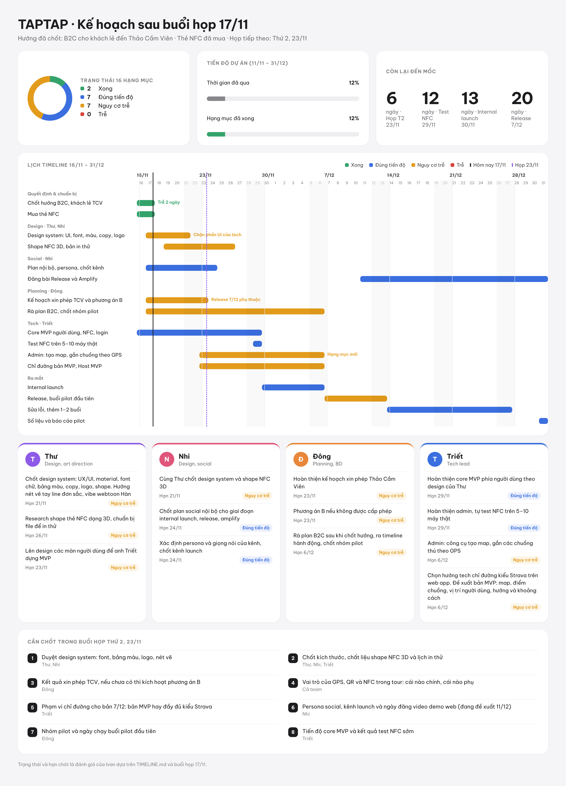

# Họp Tap Tap – 2026-11-16 (thứ 2)

Người tham dự: Cần bổ sung (ghi chú họp do anh Triết gửi)

## Đã chốt
- Hướng sản phẩm: **B2C cho khách lẻ đến Thảo Cầm Viên (TCV)**. Chốt trễ 1 ngày so với mốc 15/11 trong TIMELINE.
- Thẻ NFC: **đã mua**.
- Test NFC trên 5–10 máy thật: **anh Triết làm**.
- Hướng design: nét vẽ tay dạng line đơn sắc, vibe webtoon Hàn.
- Họp tiếp theo: **thứ 2, 23/11**.

## Next step
| Việc | Ai làm | Hạn |
|---|---|---|
| Chốt design system: UX/UI, material, font chữ, bảng màu, copy, logo, shape | Thư, Nhi | 21/11 (đề xuất) |
| Lên design các màn người dùng để tech dựng MVP | Thư | 23/11 (đề xuất) |
| Research shape thẻ NFC dạng 3D, chuẩn bị file để in thử | Thư, Nhi | 26/11 (đề xuất) |
| Chốt plan social nội bộ: internal launch, release, amplify | Nhi | 24/11 (đề xuất) |
| Xác định persona và giọng nói của kênh social, chốt kênh launch | Nhi | 24/11 (đề xuất) |
| Hoàn thiện kế hoạch xin phép TCV | Đông | 23/11 (đề xuất) |
| Phương án B nếu TCV không cấp phép | Đông | 23/11 (đề xuất) |
| Rà plan B2C sau khi chốt hướng, ra timeline hành động, chốt nhóm pilot | Đông | 6/12 |
| Hoàn thiện core MVP phía người dùng theo design của Thư | Triết | 29/11 |
| Hoàn thiện admin, test NFC trên 5–10 máy thật | Triết | 29/11 |
| Admin: công cụ tạo map, gắn các chuồng thú lên map theo GPS | Triết | 6/12 (đề xuất) |
| Chọn hướng tech cho phần chỉ đường (kiểu Strava nhưng là web app) | Triết | 6/12 (đề xuất) |

Ghi chú: hạn có chữ "đề xuất" là Ivan gợi ý theo TIMELINE.md, chờ người phụ trách xác nhận.

## Vướng / rủi ro
- Design system trễ thì phần UI của MVP trễ theo, vì tech dựng theo design của Thư.
- Shape NFC 3D cần có bản in thử trước khoảng 26/11 để kịp gắn tag và test ngày 29/11.
- Release 7/12 phụ thuộc kết quả xin phép TCV. Cần biết sớm để không làm map GPS cho địa điểm không dùng được.
- Map GPS và chỉ đường là hạng mục mới. Đề xuất bản cho 7/12 chỉ gồm: map, điểm từng chuồng, vị trí người dùng, mũi tên hướng và khoảng cách. Vẽ đường đi, ghi lộ trình kiểu Strava để sau release.

## Câu hỏi còn mở (cần chốt họp 23/11)
1. Duyệt design system: font, bảng màu, logo, nét vẽ. (Thư, Nhi)
2. Kích thước, chất liệu shape NFC 3D và lịch in thử. (Thư, Nhi, Triết)
3. Kết quả xin phép TCV; nếu chưa có thì kích hoạt phương án B. (Đông)
4. Vai trò của GPS, QR và NFC trong tour: cái nào chính, cái nào phụ. (Cả team)
5. Phạm vi chỉ đường cho bản 7/12: bản MVP hay đầy đủ kiểu Strava. (Triết)
6. Persona social, kênh launch, ngày đăng video demo web (đang đề xuất 11/12). (Nhi)
7. Nhóm pilot và ngày chạy buổi pilot đầu tiên. (Đông)
8. Tiến độ core MVP và kết quả test NFC sớm. (Triết)

Xác nhận bởi anh BeeNgyy: chưa
